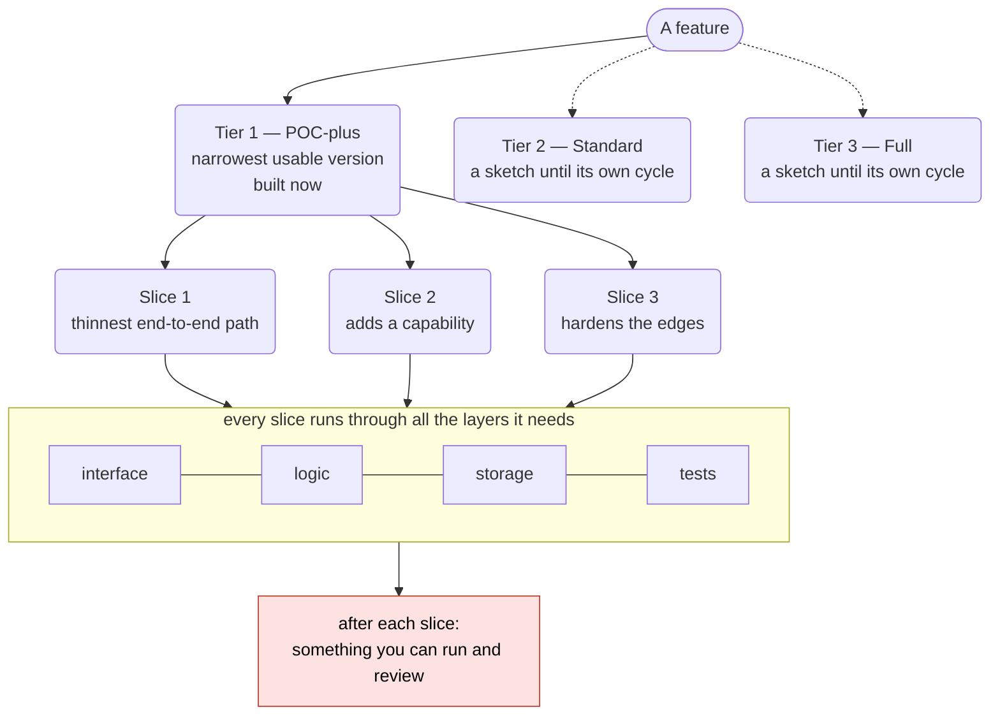
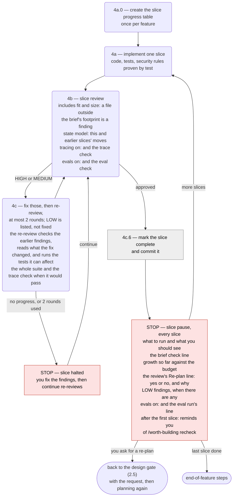
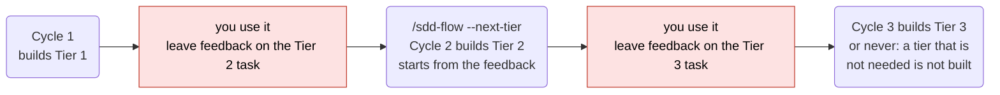

# sdd-flow — the development cycle at a glance

A picture of what `/sdd-flow` does, stage by stage, as of agent-engineering 5.1.0. It is a reading aid for people: the flow itself runs from `skills/sdd-flow/SKILL.md` and the files under `skills/sdd-flow/phases/`, and those are the source of truth when this page and they disagree.

**How to read it.** Rounded boxes are work done by a spawned subagent. Red boxes are places the flow **stops and waits for you**. Grey boxes are things the orchestrator (the main conversation) does itself: commits, running a script, recording state.

## How a feature is made small: tiers, then slices

The flow cuts a feature down twice, in two different directions, so that you have something real to use and judge as early as possible, in the smallest pieces possible.

- **Tiers cut by depth — how much of the feature exists.** Tier 1 is the narrowest version that is really usable; Tier 2 adds what a normal feature is expected to do; Tier 3 adds the rare cases, hardening, and scale. Each tier is more complete than the one before it. You use a tier before the next one is planned, and a later tier is only built if it turns out to be needed.
- **Slices cut a tier by path — one thin, working thread at a time.** A slice is one concentrated function built all the way through every layer it touches — interface, logic, storage, tests — so that when it lands there is something to run and check. The first slice is the thinnest end-to-end happy path; each later slice adds a capability or hardens an edge.

A tier says **how much** to build. Slices say **in what order** to build it.

| | Tier | Slice |
|---|---|---|
| Cuts the feature by | Depth: how complete it is | Path: one working thread through the layers |
| Size | One whole cycle of the flow, with its own brief, spec, reviews, and commits | One implement–review–commit loop inside a cycle |
| Decided at | The design gate: the brief proposes three, you pick one (Tier 1 unless you say otherwise) | Planning: the spec lists the slices for the chosen tier, starting from the brief's delivery outline |
| What you get at the end | A version of the feature you can use, and leave feedback on | A piece of that version you can run and check |
| Where you are asked | Design gate, then the completion announcement | The pause after each slice |
| What happens to the rest | Later tiers stay ten-line sketches of behaviour; their own cycle re-decides them | Later slices are already specified; they are built next, in order |

**A slice is vertical, not horizontal.** "Build the database layer, then the API, then the screen" is three horizontal layers: nothing can be tried until the last one lands. A slice goes the other way — a narrow column through all of them — which is why each one ends with something testable. The spec review rejects slices that are layers in disguise.

**There is a third cut, before either of these:** when a request is too broad for one cycle, Step 0 splits it into separately deliverable features (a decomposition), and each of those gets its own tiers and slices. A next-tier cycle skips this cut: its design brief cuts the tier to fit one cycle, moving the rest to a later tier. A feature too small to tier or slice is not forced into either — the brief says tiers are not applicable, and the spec falls back to building it whole.

## The whole cycle

```mermaid
flowchart TD
    start(["/sdd-flow task"]) --> s0("Step 0 — Scope<br/>does this fit one cycle?")
    s0 -- "too large" --> decomp["STOP — decomposition written<br/>you run /sdd-flow per item"]:::stop
    s0 -- "fits" --> s15["Step 1.5 — Clarification gate<br/>STOP — clarify first? y/n<br/>y: you run /research-clarify"]:::stop
    s15 --> s2("Step 2 — Research<br/>2a research and completeness check<br/>2b ADR candidates listed for the design gate<br/>no review: the design gate is its check")
    s2 --> c2["2e commit research"]:::orch
    c2 --> s25a("Step 2.5a — Design brief<br/>at most 150 lines, plain language<br/>proposes three tiers, writes the tier plan<br/>draws the workflow, if it branches<br/>draws the state model, if things move through states")
    s25a --> gate["Step 2.5b — Design gate<br/>STOP<br/>answer questions, pick a tier,<br/>accept ADR candidates, approve<br/>reminds you of /worth-building<br/>model feature, no tracing foundation:<br/>recommends /observability-init<br/>(not Python: says it is Python only)"]:::stop
    gate -- "answers or changes" --> s25c("2.5c — Revise the brief")
    s25c --> gate
    gate -- "approve" --> m1["Look again for the tracing foundation<br/>Write the accepted ADRs<br/>Mirror tiers to BB tasks<br/>tier being built: in progress"]:::orch
    m1 --> s3a("Step 3a — Specification<br/>covers the approved tier only<br/>lists what is deferred<br/>no meaningful slices: whole-feature,<br/>with the reason shown at 3g")
    s3a --> s3c("3b capture ADRs<br/>3c specialist panel, in parallel —<br/>only the areas the change touches, at most 3<br/>scope beyond the brief is proposed, never added<br/>then one synthesis")
    s3c -- "findings" --> fix3("fix the spec, re-run the panel<br/>at most 2 rounds")
    fix3 --> s3c
    fix3 -- "no progress" --> halt3["STOP — panel halt<br/>you fix the spec by hand"]:::stop
    s3c -- "proceed" --> s3d("3d critical review of the spec<br/>3e fix HIGH and MEDIUM findings<br/>3e.5 check the fix")
    s3d -- "still open after one more fix" --> halt3e["STOP — fix-check halt<br/>you fix the spec by hand"]:::stop
    s3d --> c3["3f commit planning"]:::orch
    c3 --> s3g["3g — STOP after the spec, every time<br/>departures from the brief, the panel's proposals<br/>run /simplicity-challenge --brief, then<br/>approve, or cut / accept to change the spec"]:::stop
    s3g -- "cut or accept" --> fixg("change the spec as asked,<br/>commit it, stop again")
    fixg --> s3g
    s3g -- "approve" --> s4{"Step 4 — Implementation<br/>route on delivery mode"}
    s4 -- "per-slice" --> slices("Per-slice cycle<br/>see the next diagram")
    s4 -- "whole-feature" --> wf("4a implement, security rules proven by test")
    slices --> cr
    wf --> cr("4b code review of the whole feature, on the second model<br/>spec, fit and size, the brief's footprint,<br/>and an adversarial pass: how would it break?<br/>state model: the code's state writes against it<br/>tracing on: compares a real run with the planned calls<br/>evals on: checks what the model really answered<br/>4c fix HIGH and MEDIUM")
    cr --> eof("4e.5 final check — every tier, on the second model<br/>security verification, whole suite, last look at the tests<br/>state model: checked once more<br/>tracing on: and the trace check, once more<br/>evals on: and every eval case, once more<br/>4f completion: summary, tier plan updated")
    eof -- "still open after 2 fix rounds" --> halt45["STOP — final check halt<br/>you resolve, then continue"]:::stop
    eof --> m2["Mirror: tier in review"]:::orch
    m2 --> q4h{"4h — does a requirement wait for your sign-off<br/>(evals on only), or is the feature over<br/>1.5× its growth budget?"}
    q4h -- "yes" --> s4h["STOP — scores and growth shown<br/>yes commits and accepts"]:::stop
    s4h --> c4
    q4h -- "no" --> c4["4i commit implementation"]:::orch
    c4 --> done["4j — Mirror: tier done<br/>short report: shipped, deferred,<br/>LOW findings listed, diff size<br/>state model: matched, or deviations<br/>reminds you of /retro<br/>progress file rotated"]:::orch
    done --> next(["later: /sdd-flow --next-tier<br/>a new cycle for the next tier"])

    classDef stop fill:#fde2e2,stroke:#c0392b,color:#000
    classDef orch fill:#eeeeee,stroke:#888888,color:#000
```

## Inside per-slice implementation

When the spec says `delivery_mode: per-slice` (the default for new specs), this loop runs once per slice, in order. Then the end-of-feature steps in the diagram above run once.

## What happens at each stage

**Who reviews.** Wherever the table says a review is done by a second model, it is run by a different model family than wrote the work — the Codex CLI. Where Codex is not available, or its run fails twice, that review falls back to a Claude subagent (Opus for the spec critical review, the feature code review, and the panel synthesis, Sonnet for the rest); the cycle goes on, and you are told. Every review document says who reviewed it.

**Tests.** The final check (4e.5) always runs, and checks once more that no fix weakened a test or left one out of the run. Before that, the code review and each slice review check that the tests are real: that none was weakened or left out of the run, that expected values come from the spec, that each test fails when the behaviour is broken, and that the code was not fitted to the tests' inputs.

**Fit and size.** The code review and each slice review also ask whether the change fits the code it lands in: does it match its style and patterns, reuse what exists, stay as small as the tier allows, and sit where the next person would look. A changed file outside the brief's "What changes where" areas is a finding unless the spec records it as a departure. A finding that adds a file, a layer, or a duplicate helper is MEDIUM and must be fixed — by removing or merging code, never by adding it; each fix round reports its net line change.

**Tracing.** In an application that has the tracing foundation (`/observability-init` was run on it), a cycle also plans which calls the feature makes and checks them against a real run: whether the application has it is settled when you approve the design brief, the spec draws a planned call graph (3a), the gate is settled at 3c, the implementer follows the tracing standard (4a), and the slice review, the code review, and the final check each compare the call tree a real run recorded with the plan, writing `SDD/.records/reviews/TRACE-TREE-*`. Without the foundation none of this happens. `observability-diagram.md`, beside this file, draws it.

**Evals.** In such an application, a feature with a model in it is also checked on what the model really answers. You decide at the design gate which behaviours a rule checks and which you will accept yourself; the spec writes the cases out (3a) and the gate is settled at 3c; the implementer builds the cases and, the first time, the eval run (4a). Before the slice review, the code review, and each round of the final check, the flow puts every case to the running application, three times each, and the review reads the results, kept as `SDD/.records/reviews/EVAL-RESULTS-*`. A case checked by rule that fails is a finding, like a failing test. A case scored by a judge model blocks nothing: its scores are shown to you before the final commit (4h) — the one reason that step stops. Without the foundation, or for a feature with no model in it, none of this happens. `observability-diagram.md` draws this as well.

**State model.** When something a feature changes moves through named states — a status, a lifecycle, a job that queues, runs and fails — the design brief draws them as a diagram, with the moves that must never happen listed beneath it, and you approve it with the brief. The spec gives each move a requirement, the implementer tests each one (a forbidden move: that it is refused), and the slice review, the code review, and the final check draw the states from the code's writes and compare. A forbidden move the code allows is a HIGH finding. The end report says whether the code matched. No gate and no new stop: a feature with no states has no state model, and its cycle runs as before.

| Stage | What is done | Who does it | What it writes (under `SDD/`) | Where it can stop |
|---|---|---|---|---|
| 0 Scope | Decides whether the request fits one cycle. `--next-tier` instead reads the tier plan and copies task comments into its Feedback, and makes no scope check — the design brief cuts the tier to fit one cycle | Sonnet subagent | `flow/DECOMPOSITION-*` (only when too large) | Always, when the feature is too large |
| 1.5 Clarification | An interview that gets your design concept written down. On a next-tier cycle it is a feedback interview instead | You, with `/research-clarify` | `research/CLARIFICATION-*` | Every time — yes or no — unless the file exists |
| 2 Research | Investigates the codebase; finds cross-cutting decisions and lists them as ADR candidates for the design gate. Not reviewed: you check the design built on it at the gate | Sonnet subagents | `research/RESEARCH-*` | — |
| 2.5 Design gate | Writes the one planning document meant for you: what will be built, decisions, the existing code it builds on, footprint (every new file by name), a growth budget, tiers, questions — with a flowchart of how it will work when that has a decision or more than one actor, and a state diagram with the moves that must never happen when something moves through named states. Then waits. It also lists the proposed ADRs; approving writes them, and you can drop any by name | Opus subagent writes; you approve | `requirements/DESIGN-*`, `flow/TIERS-*`, `adr/*` (on approval) | **Every time the brief is written or rewritten.** `approve` is refused while a question is open |
| 3 Planning | Writes the spec for the approved tier; specialist panel (only the areas the change touches; scope beyond the brief is proposed to you, never added) and adversarial review; fixes. The spec must record every departure from the brief, a new file the brief does not name included. With a state model, each allowed move gets a requirement and each forbidden one an edge case | Sonnet subagents for the spec and the panel, Opus for the panel's synthesis; a second model for the adversarial review | `requirements/SPEC-*`, `.records/reviews/PANEL-*`, `.records/reviews/CRITICAL-SPEC-*` | Panel halt after 2 rounds or no progress. **3g, every time: you approve the spec, after cutting it down if you choose** |
| 4 Implementation | Builds the feature (whole, or slice by slice); the implementer proves each security rule with a test that fails when its guard is removed, and tests every move of the state model. Each slice is reviewed; then one code review of the whole feature — against the spec, the tests, fit and size, and an adversarial pass — and fixes. A review passes with no HIGH or MEDIUM finding; LOW findings are listed for you, not fixed. A review after a fix round checks the earlier findings and reads what the fix changed; a slice re-review runs only the tests the fix can affect, and the whole suite and the trace check when it would pass the slice. Then the final check: a second model reads every security rule for a path on which it does not hold, runs the whole suite, reads the tests once more, compares the code's state writes with the state model, and with the gates on repeats the trace and eval checks; at most two fix rounds. Completion | Opus subagents for the code, Sonnet for fixes and completion; a second model for the reviews and the final check | code and tests, `implementation/*`, `.records/reviews/REVIEW-*`, `.records/reviews/FINAL-CHECK-*` | Slice pauses (per-slice). Slice fix-loop halt. Final check halt. 4h before the final commit, only when a requirement waits for your sign-off or the feature is over its growth budget |
| Done | Tier marked shipped in the tier plan; task set to done; a short report: what shipped, what was deferred, the LOW findings listed and not fixed, anything left unproven, the diff size and the growth against the budget | Orchestrator | updated `flow/TIERS-*` | — |

**What is committed.** The brief, the spec, the implementation plan and slice files, ADRs, the glossary, the tier plan, and the summary go into git with the code. Everything else the flow writes — progress, reviews, trace trees, eval results, call logs, compaction files — is a process record in `SDD/.records/`, which ignores itself: it stays in the checkout that ran the flow, and `worktree-merge` copies a worktree's records into the main checkout before the worktree goes away.

## What the stops are for

| Stop | When | Why it exists |
|---|---|---|
| Decomposition (Step 0) | always, when too large | The request is too large for one cycle (never on `--next-tier`) |
| Clarification (1.5) | every time, unless a clarification document exists | Your intent has to be written down before research. Answer yes to run `/research-clarify`, no to go on |
| Design gate (2.5) | every time the brief is written or rewritten | You approve *what will be built* before anything is specified. A feature that calls a model in an application with no tracing foundation gets a recommendation to run `/observability-init` first (a non-Python application is told the foundation is Python only); the flow looks again on approval. Approving the brief approves its state model, when it has one |
| Tracing or evals asked for and not possible (3c) | when it applies | The spec says `tracing: true` or `evals: true` and the application had no tracing foundation when the brief was approved, or one of the two fields holds a value other than `auto`, `true`, `false`. You change the field in the spec; nothing is reviewed until you do. It cannot fire with both fields left at `auto` |
| Panel halt (3c) | when it applies | The spec did not pass the specialist panel in 2 rounds, or a round made no progress. You fix the spec by hand |
| Fix-check halt (3e.5) | when it applies | The check after the spec fix still found a HIGH or MEDIUM finding open after one more fix. You fix the spec by hand |
| Stop after the spec (3g) | every time | The spec may have grown since you approved the brief. It shows the departures from the brief and the scope the panel proposed but did not add, and points you to `/simplicity-challenge` with the brief. `approve` starts building; `cut …` or `accept …` changes the spec first, and the stop is shown again |
| Slice fix-loop halt (4c) | when it applies | A slice did not pass its review in 2 fix rounds, or a round made no progress. A test failure that only the whole-suite run at the end of a re-review found does not count against progress. A LOW finding is listed, not fixed, and cannot cause this stop. You resolve the findings; `continue` re-reviews the slice |
| Slice pause | after every slice | Try the slice while it is small: it says what to run and what you should see, the brief check, the growth so far against the budget, the LOW findings the review listed, and the review's `Re-plan:` line. `continue` starts the next slice; ask for a re-plan in words and the brief is revised, the design gate stops for you, and planning runs again |
| Eval run could not be made (before a review, evals on) | when it applies | The application's model could not be reached, twice, when the flow ran the feature's eval cases before a review. Nothing is reviewed until it can be: you fix the network, the key, or the provider's limit, and continue. It costs no fix round |
| Final check halt (4e.5) | when it applies | The final check still has a HIGH or MEDIUM finding after 2 fix rounds — most often a path on which a security rule does not hold; with tracing on, a difference between the planned calls and a real run; with evals on, a case checked by rule that the application still fails. It also covers the completion step finding something that needs code or tests changed after that check. You resolve the findings; `continue` runs the final check again |
| Sign-off or size before the final commit (4h) | only when evals are on and the spec leaves a requirement about a model's answers for you to accept, or the feature adds more than 1.5× the source or test lines in its growth budget | It shows each such requirement with the judge's scores and where the outputs are, and the growth against the budget; yes commits and accepts. Otherwise the flow commits without stopping and ends with a short report |
| A stop record `continue` does not recognise | always | A stop left by another version. It is shown to you as written; the flow never guesses what it was waiting for |
| A subagent failed twice | always | The same step failed, was retried with more context, and failed again |
| Broken install or old folder layout | always | A file the flow ships — the OWASP catalog included — is missing, or the repo still uses the 1.x `SDD/` layout. Not resumable until fixed |

Every stop above that waits for your answer is written to `SDD/.records/progress.md` before the flow asks, and `/sdd-flow continue` resumes from that record. The rest write no such record: the slice pause needs no answer (`continue` starts the next slice), and after a decomposition, a broken or old-layout install, or a twice-failed subagent you deal with the cause and run the flow again.

## Tiers across cycles

A feature is delivered in up to three tiers — Tier 1 POC-plus, Tier 2 Standard, Tier 3 Full — and each tier is one full pass through the first diagram. The rules for what belongs in which tier live in `skills/simplicity-challenge/references/tiers.md`. Every tier is reviewed in full, with the same final check.

The tier plan (`SDD/flow/TIERS-[feature-name].md`) carries what shipped, what was deferred, and the feedback from one cycle to the next. BB tasks mirror it: one parent task per feature, one sub-task per tier.
