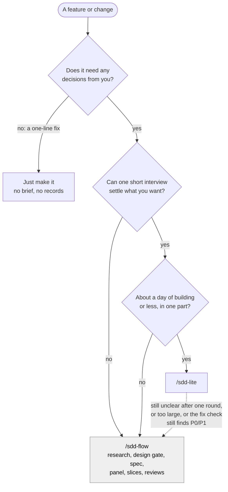
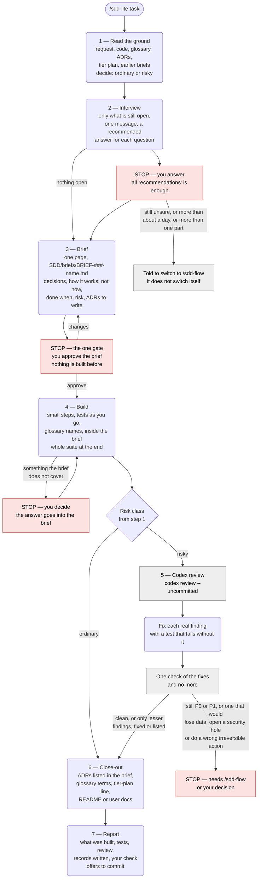

# sdd-lite — the light build path at a glance

A picture of what `/sdd-lite` does, step by step, as of agent-engineering 3.16.0. It is a reading aid for people: the skill itself runs from `skills/sdd-lite/SKILL.md`, and that file is the source of truth when this page and it disagree.

**How to read it.** Every box is work done in the main conversation — `sdd-lite` spawns no subagents. Red boxes are places it **stops and waits for you**. Grey boxes are the one step done by another model (the Codex review) and the hand-off to `sdd-flow`.

## Which path: sdd-lite or sdd-flow

`sdd-lite` exists because, on clear tasks, `sdd-flow` cost 15 to 44 times a plain build without better code, and later cycles reopened only a few of its records: your decisions, the decision records (ADRs), the glossary and the tier plan. `sdd-lite` keeps those, updates the user docs the change needs, and writes no other process records.

## The whole run

## What happens at each step

| Step | What is done | What it writes | Where it can stop |
|---|---|---|---|
| 1 Read the ground | Reads the request and the code it touches, and, when they exist, `SDD/UBIQUITOUS_LANGUAGE.md` (the glossary), `SDD/adr/`, the feature's tier plan and earlier briefs. Sets the risk class: **risky** when the change touches authentication, secrets, personal data, payments, deleting or migrating stored data, an exposed network surface, an agent acting on untrusted input, an effect that cannot be recalled, or anything else expensive to get wrong. When unsure, risky | — | — |
| 2 Interview | Asks only what the request, the code and the records leave open and what changes what gets built. Each question carries a recommended answer and its consequence | — | Waits for your answers. Points you to `/sdd-flow` when you are still unsure after one round, or the work is more than about a day or more than one part |
| 3 Brief | One page: what you can do afterwards, your decisions (quoted), how it will work (with `file:line` for today's code), what is left out, how you will check it, the risk class, and the decision records to write with their alternatives and consequences | `SDD/briefs/BRIEF-###-name.md` | **Always.** Nothing is built until you approve; approving also approves writing exactly the listed ADRs |
| 4 Build | Builds and tests in the conversation. Tests follow `sdd-flow/references/test-integrity.md` §1, with the brief in place of the spec; a changed or removed test is one line under `## Test changes` in the brief | code and tests | When the work reaches something the brief does not cover that changes what you get |
| 5 Review | Ordinary: none. Risky: one Codex review, fixes with tests, one check of the fixes. No Codex CLI: asks whether to go on without one | — (no review report) | When the check still reports a P0 or P1 finding (Codex's top two priorities), or one you judge would cause data loss, a security hole or a wrong irreversible action |
| 6 Close-out | Writes each ADR the brief listed through `cross-cutting-adr` (pre-approved); a new binding decision that came up while building is shown to you first. Adds the change's terms to the glossary, one dated line to the tier plan, and what a user needs to the README | `adr/*`, glossary, tier-plan line, user docs | Only to ask about an ADR the brief did not list |
| 7 Report | What was built, test result, review result or "no review (ordinary)", records written, what is not done, your check | — | Offers to commit; never commits unasked |

## What it leaves behind

| Kept | Not written |
|---|---|
| The brief (`SDD/briefs/`) — the record of *why* | Research document |
| ADRs (`SDD/adr/`) for decisions that bind later work | Spec, implementation plan, slice files |
| Glossary entries (`SDD/UBIQUITOUS_LANGUAGE.md`) | Specialist panel, site counts |
| One tier-plan line, when the feature has a tier plan | Review reports, progress logs, run logs |

Any other file a `sdd-lite` run writes under `SDD/` is a sign the full flow is being rebuilt by hand: if the work needs it, it needs `/sdd-flow`.
