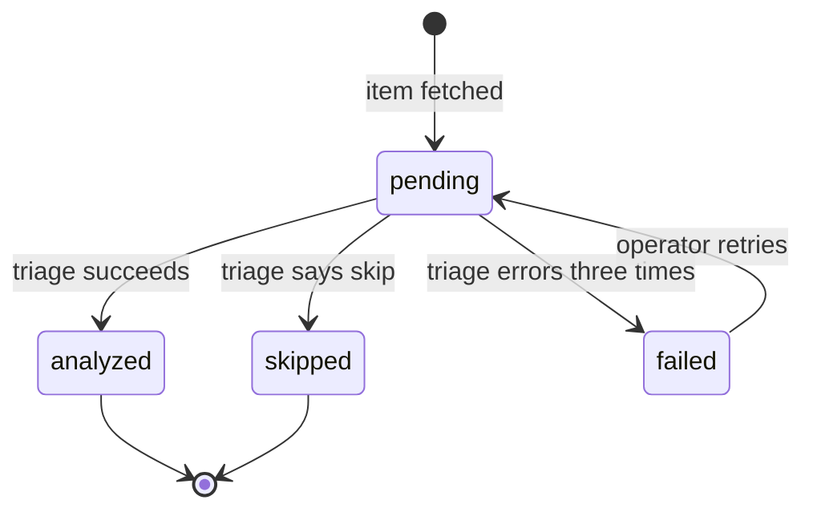

# State Model — the states a feature allows, approved in the brief and checked in the code

The one definition of a feature's state model in `sdd-flow`: what it is, how the design brief draws it, how the spec maps it, what the implementer tests, and how the reviews compare the code with it (the State Check). The design brief, the spec and its reviews and fixes, the implementer, the slice review, the code review, the final check (4e.5), and every fix spawn of Step 4 read this file at the `STATE_MODEL` path in their prompt, and never restate it.

There is no gate. Every design brief says whether the feature has a state model (§1), and the spec follows it (§3). **From Step 4 on, a spec with no `### State model` section has none:** the implementer and the reviews do nothing for it and write nothing about it, and the build runs exactly as it did before state models were part of the flow — including a cycle whose spec was written before them.

## 1. What a state model is, and when a feature has one

A **state model** is the set of named states one thing can be in, the moves between them that are allowed, each labelled with the event that causes it, and the moves that must never happen. It is written for the thing the feature adds or changes, not for the whole application.

A feature has one when something it adds or changes **moves through named states over time**: a status column, a lifecycle, a job that queues, runs, retries and fails, an approval that waits, a record that is drafted, published and retired. A calculation, a single call, a page with no lifecycle, a report: none.

The design brief decides, in `## How it will work`: it draws the diagram (§2), or it writes the one line `State model: not applicable — [reason]`. A feature whose change touches an existing lifecycle — a new state, a new move, a move that now happens from somewhere new — has one, drawn for the states it touches and the moves into and out of them.

## 2. How the brief draws it

A Mermaid `stateDiagram-v2` block — a text format that renders as a picture — then the forbidden moves beneath it. It is the one place the brief may hold something other than plain words.

````markdown
**State model — [the thing], held in [where: a column, a field, a file].**



**Never:**
- analyzed → pending, or analyzed → completed — a re-fetch of an item already triaged must not send it back to triage.
- skipped → analyzed — a skip is final unless the operator retries.
````

- **Every state**, with the name the code will use. `[*]` marks where a thing starts and the states it can end in.
- **Every allowed move**, labelled with the event that causes it — what happens, not the function that does it.
- **The forbidden moves under `**Never:**`**, one line each, with why. A diagram cannot show an arrow that must not exist, and the moves that must never happen are where the bugs are: a shipped order cancelled, a paid invoice paid again, an item sent back to a queue it already left. List every one a reader could expect to work and that must not, not every pair of states.
- **Ten to twenty lines** with the list. A thing with more states than fit is drawn for the states this feature touches, with one line naming the rest.

## 3. How the spec maps it

The spec carries `### State model` under `## Modules`, after the module entries:

- **The brief's diagram and its `**Never:**` list, copied unchanged**, and the line naming where the state is held.
- **A table beneath it:** each allowed move with the `REQ-XXX` that requires it, each forbidden move with the `EDGE-XXX` that requires it to be refused — and what a refusal does (an error, a no-op, a log line), which the EDGE states.
- **Per-slice mode:** every slice gets a `State moves:` line naming the moves, allowed and forbidden, that it brings into existence — each in exactly one slice's line, the first slice after which its test can pass — or `none`.
- **The spec's model is the brief's.** A move or a state added, removed, or changed is a deviation, recorded under `## Deviations from Design Brief` like any other, which the owner sees when the flow stops after the spec. When the brief says `not applicable` and the spec finds the feature does move through states, the spec draws the model and records that as a deviation.

**What the spec critical review (3d) checks** — in its Design Brief Fidelity block, with these severities:

| Finding | Severity |
|---|---|
| The spec's model differs from the brief's — a state or a move, allowed or forbidden — and the difference is not recorded as a deviation | HIGH |
| An allowed move with no `REQ`, or a forbidden move with no `EDGE` | MEDIUM |
| The brief or the spec says `not applicable` for a feature whose requirements plainly move a thing through named states | MEDIUM |
| Per-slice: a move on no slice's `State moves:` line, or on more than one | MEDIUM |

A spec fix resolves them by restoring the brief's model, by adding the missing `REQ`, `EDGE`, or slice line, or by recording the deviation. It never deletes a forbidden move to make a finding go away.

## 4. What the implementer tests

Read with TEST_INTEGRITY §1: each of these is a real test by that standard.

- **One test per allowed move:** put the thing in the move's from-state, cause the event, and check it is in the to-state.
- **One test per forbidden move, proving it is refused:** put the thing in the from-state, try the move by every way the code offers that the spec names — the call, the route, the job — and check it is still in the from-state, and that the refusal is what the EDGE says.
- **Where the state is written, keep it findable.** Write the state through the place the code already writes it. A second place that writes the same state is a fit finding unless the brief names it (FIT §2).

In per-slice mode, a slice tests the moves on its own `State moves:` line.

## 5. The State Check — what the reviews do

The slice review, the code review, and the final check run it, each at the `SCOPE` its prompt gives. It reads the code; it does not run the product.

**Scope.**
- **`SCOPE = SLICE-XXX`:** the moves on this slice's `State moves:` line and on those of every slice before it — so a slice that breaks an earlier slice's move is caught at its own review. A later slice's moves are never held against this one.
- **`SCOPE = FEATURE`:** every move in the spec's model.

**Draw the as-built model.**
1. **Find where the state is held** — the line naming it in `### State model`, then the enum, the column, or the field in the code.
2. **Find every write to it.** Search the whole repository, not only the changed files: an assignment to the field, an ORM update or save, a bulk update, a raw SQL `UPDATE` or `INSERT` naming the column, a default in a migration or a model, a write by another service or a script that the repository holds, and a read-modify-write through a generic update function that can carry the field. For each write, note which states it can be called from — the condition around it, or none — and which state it writes.
3. **A write you cannot place** — you cannot tell which states it is called from, or which state it writes — is a finding of its own (§6). Do not assume it is harmless.
4. **Draw the as-built diagram** from those writes, in the same Mermaid form as §2, into the review.

**The boundary.** The spec's model is drawn for the states the feature touches (§1). A move whose two ends are both states the model does not draw — another part of an existing lifecycle — is outside the check: list it under *Writes to the state* as `outside the model` and grade nothing about it. A move with at least one end in a drawn state is inside it.

**Compare** the as-built diagram with the spec's, move by move, in scope:

- every allowed move: is there code that makes it, and a test by §4?
- every forbidden move: is there no code path that makes it, and a test by §4 that it is refused?
- every move inside the boundary in the as-built diagram: does the spec's model have it, and each state it reaches?

## 6. Findings, and how each is resolved

A finding comes from this table or it is not a State Check finding.

| Finding | Severity |
|---|---|
| The code allows a forbidden move — some path writes the to-state while the thing is in the from-state | HIGH |
| The code allows a move inside the boundary that the spec's model does not have, between states the spec's model does have | HIGH |
| A forbidden move in scope with no test that it is refused | HIGH |
| An allowed move in scope with no code that makes it, or no test that it happens | MEDIUM |
| A state a move inside the boundary reaches, or starts from, that the spec's model does not have | MEDIUM |
| A write to the state that cannot be placed (§5, step 3) | MEDIUM |

- **By changing the code or the tests.**
- **A MEDIUM may instead be recorded** under `### Implementation Deviations` in the IMPLEMENTATION-PLAN, with the reason. A difference recorded there before the review is listed as recorded and not raised again.
- **A HIGH is never resolved by recording it.** A forbidden move the code allows is closed in the code, and proven by a test; a move the spec does not have is removed from the code. If the owner wants it, that is a change to the brief and the spec, made by the owner, not by a fix round.
- **Never by editing the spec's `### State model`, its table, or a `State moves:` line to match the code.**

State Check findings are ordinary review findings: number them with the review's others, count them in its progress marker, and a HIGH rejects.

## 7. What goes in the review document

```markdown
## State Check

**State model:** matched | <n> recorded deviation(s) | <h> HIGH, <m> MEDIUM open
**Scope:** <SLICE-XXX | FEATURE> — <n> allowed move(s), <n> forbidden move(s); state held in <where>

[The as-built diagram, in Mermaid]

| Move | Kind | In the code | Test | Verdict |
|------|------|-------------|------|---------|
| pending → analyzed | allowed | `triage.py:88` | `test_triage_marks_analyzed` | matched |
| analyzed → pending | forbidden | `store.py:41` writes `pending` on every re-fetch | — | HIGH: allowed by the code |

**Writes to the state:** [each write found, `file:line`, from-states → to-state; or the ones that could not be placed]
**Recorded deviations:** [each, or `None.`]

[Each finding, numbered with the review's others: severity, the row of §6 it comes from, the move or write, and the fix.]
```

When the spec has no `### State model`, write no section.

The `**State model:**` line of the last final check is what the end-of-feature report (4j) shows the owner: `matched`, or the deviations recorded.
