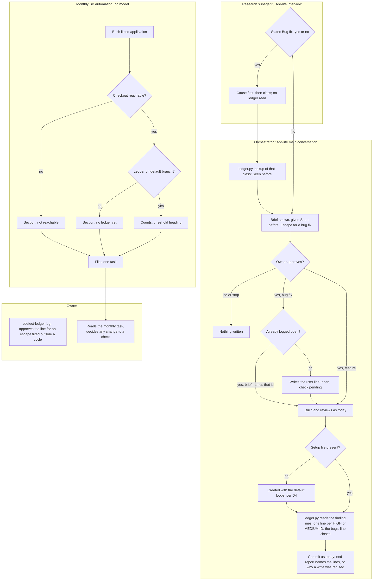
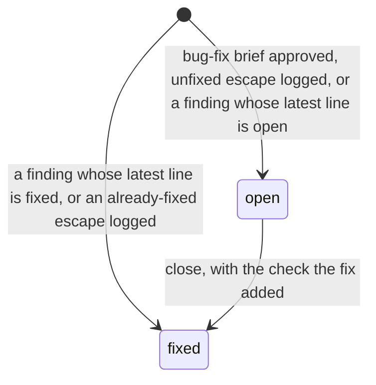

# DESIGN-002-defect-ledger
Based on: RESEARCH-002-defect-ledger.md
## In one paragraph
Each application gets a **defect ledger** — `SDD/defects.jsonl`, committed, one line per HIGH or MEDIUM defect: which loop caught it (a *loop* is a check that can catch a defect: slice review, code review, final check, CI, integration, or a user; `ci` and `integration` count only once an application declares them), its *class* (a short name for the kind of defect), and the check the fix added. Both flows write it: sdd-flow just before its final commit, sdd-lite at close-out, from the *finding lines* of the reviews they ran — one fixed line at the head of every review finding, giving its ID, severity, place and state, which a separate change released first as 5.4.0 puts in the reviews. A bug fix of shipped work also gets an `## Escape` section in its brief — what introduced it, which loop missed it, and *Seen before* (earlier lines of the same class, which the orchestrator looks up after research) — and its line is written `open` when the brief is approved and closed when the fix lands. One stdlib script, `ledger.py`, is the only reader and writer; a `/defect-ledger` skill is the owner's way in, and a monthly BB automation files one report-only task covering the five applications.
## What you will be able to do afterwards
- Finish an sdd-flow or sdd-lite cycle and find its review findings in the application's ledger, named in the end report; approve a bug-fix brief that tells you whether this kind of defect happened before and what check failed to hold.
- Run `/defect-ledger report | log | lookup` without remembering the script's fields.
- Read one BB task a month in the claude-plugins project: per application, the share each loop caught, repeated classes, checks with no catches since added, open escapes — headed *below threshold — counts only* under 5 features or 30 lines.
## How it works today
- Review findings live only in git-ignored files under `SDD/.records/reviews/`; from 5.4.0 (built first, separately) each opens with a finding line and re-reviews repeat its ID. No step knows whether a task fixes a shipped defect; no brief records an escape. sdd-flow commits at 4i (`agent-engineering/skills/sdd-flow/phases/end-of-feature.md:116`) and announces at 4j (`:128`); sdd-lite writes no review report. The glossary's "the ledger" already means the learnings ledger (`flow-state/SDD/UBIQUITOUS_LANGUAGE.md:97`), so this feature always says "defect ledger".
## How it will work

**State model — one defect line, held in its `status` field in `SDD/defects.jsonl`.**

**Never:**
- fixed → open — a later repeat is a new line, not a reopened one.
- fixed → fixed — closing twice; `close` refuses a line that is not `open`.
- any change to a field other than `status` and `check_added`, or to a line's `id` — the history the report counts must not move.
## Key decisions
### D1: Lines are written at the start of 4i, so the existing commit carries them; a failed write never blocks it
- **Chosen:** the orchestrator writes review lines and closes a bug's line just before the 4i commit, and names them (or the reason a write was refused — a review whose findings carry no finding line is refused by name) at 4j.
- **Instead of:** writing at 4j with a one-file commit like the task mirror's (`end-of-feature.md:149`), or stopping at 4i on a failed write.
- **Why:** the ledger must be committed and 4j runs after the commit (research, open point 1); a stop exists only for an owner's decision, so today's commit behaves as before.
- **If this is wrong:** cheap — move the step.
### D2: The finding line is a prerequisite, delivered first as 5.4.0
- **Chosen:** this cycle reads the finding line that the separate 5.4.0 change puts in the slice review, code review and final check bodies and in sdd-lite's review prompt: every finding opens with a line such as `FINDING F3 | MEDIUM | src/cart.py:42 | open` (`-` with no file), a re-review repeats `F3 | fixed`, the first final check also lists the code review's IDs, and sdd-lite's review runs as `codex exec` with that prompt. This cycle changes none of them.
- **Instead of:** building the finding line in this cycle (revision 3), or the orchestrator reading each review's prose (revision 2).
- **Why:** the owner's choice (revision 4): it ships and is used on its own first, so `ledger.py`'s parse is written against reviews that already carry it.
- **If this is wrong:** cheap — if 5.4.0 is not released when this build starts, the build waits; nothing here edits a review body.
### D3: One ledger line per HIGH or MEDIUM ID, its state from its latest line
- **Chosen:** `ledger.py` reads one chain's reviews in order — a slice's reviews; or the code review and the final-check rounds, whose first round lists the code review's IDs (D2) — and writes each HIGH or MEDIUM ID once, from the review where it first appears: `fixed` when its latest line says so, else `open` — a finding you accepted unfixed at the final-check halt shipped, so the report lists it. `found_by` follows that review (slice review, code review, final check); `introduced_by` stays empty — it never shipped; `check_added` is the test or rule the closing evidence names, else `none`; `source` is the review file and the ID. sdd-lite's 5.4.0 prompt already asks Codex for HIGH / MEDIUM / LOW, so no map is applied; its `source` is "codex review of `<brief file>`, F3".
- **Instead of:** one line per review file (a re-reviewed finding counted twice); not writing a finding left unfixed (Q3's other option).
- **Why:** research, *Fixed-ness is not in the first review*; Q3 answered with its recommendation — dropping an unfixed finding would hide what the report is for.
- **If this is wrong:** cheap.
### D4: The first write creates the setup file; `unclassified` is the standing class
- **Chosen:** a write in an application with no `SDD/defects-setup.json` creates it with the four plugin loops (slice review, code review, final check, user) and the class `unclassified`, and the end report says so; `ci` and `integration` are never added for you. A writer meeting a new kind of defect uses `unclassified`, and the end report proposes a name for the owner to add.
- **Instead of:** refusing the write until you set it up through `/defect-ledger`; stopping to ask for a class, or guessing the nearest one.
- **Why:** Q2 answered with its recommendation — the ledger counts from the first cycle and you edit the file afterwards; a new class name needs your approval, and this records the defect now and asks without a stop.
- **If this is wrong:** cheap. Re-labelling an old line is an owner edit by hand for now.
### D5: Research states the bug fix and its cause; the orchestrator looks up the history
- **Chosen:** research's first line states `Bug fix: yes | no`; when yes, a section states the cause, then the class — research never reads the ledger. The orchestrator then runs `ledger.py lookup` for that class and passes its lines (*Seen before*) to the design-brief spawn. sdd-lite's main conversation does both in step 1, the lookup after the cause.
- **Instead of:** research running the lookup itself (revision 3); a task flag (removed in 4.0.0), or detection at setup, which has not read the cause.
- **Why:** the owner's choice (revision 4); research keeps no ledger path in its prompt, and the class is settled before any history is read, which guards against anchoring on an old diagnosis.
- **If this is wrong:** cheap — a wrong "no" misses one `## Escape`, which the owner sees at the gate.
### D6: Duplicate ids are refused, renumbered by hand
- **Chosen:** every `ledger.py` command refuses a ledger holding a duplicate `id`, naming the lines; whoever merges renumbers them. `worktree-merge` is unchanged.
- **Instead of:** teaching `worktree-merge` to renumber ids inside the ledger and the briefs that name them.
- **Why:** two branches appending give a plain git conflict (research); a duplicate stays loud, never silent.
- **If this is wrong:** moderate — the merge change is deferred, not dropped.
### D7: One definition of the format, one reader — `ledger.py`, also for the monthly report
- **Chosen:** fields, loops and both maps live in `ledger.py`'s docstring. `summary` takes one or more application folders and, for the automation, reads each one's committed default branch (origin's recorded default — `currents` is `master`), never the working tree. An application whose checkout is not on the server host (Sift) gets a section saying "not reachable from the server host" each month until you choose a route. The automation is a short script in BB that calls the installed plugin's `ledger.py` and files one task with the `bb` CLI; its application list sits in the automation's environment. The cycle ends by showing the owner the exact `bb automation create` command (1st of the month, 09:00, the owner's timezone to fill in); the owner runs it.
- **Instead of:** a new `references/` file for the format; a separate report script in the repo whose stored copy must be refreshed by hand; reading Sift from its git remote or over ssh, which needs credentials in an unattended job.
- **Why:** Q1 answered with its recommendation — no credentials in an unattended job, and the gap shows every month; the script already checks every field; the owner's paths stay out of a published plugin; the risky reads sit under `ledger.py`'s tests; an automation under the owner's account is read before it exists.
- **If this is wrong:** cheap.
## Builds on
- `agent-engineering/skills/sdd-flow/scripts/growth.py:1` — script conventions: usage docstring, exit codes, stdlib only, git called as a subprocess.
- `agent-engineering/skills/sdd-flow/phases/end-of-feature.md:116` — 4i, where the lines are written before the commit.
- `agent-engineering/skills/sdd-flow/phases/design-gate.md:15` and `:59` — the brief's spawn, given the lookup's lines; `approve`, after which the bug's `open` line is written.
- `agent-engineering/skills/sdd-flow/phases/implementation-per-slice.md:20` — the owner table the new step gets a row in.
- `agent-engineering/skills/sdd-flow/bodies/slice-review.md`, `bodies/code-review.md`, `bodies/final-check.md` — the finding line from 5.4.0 (D2), which `ledger.py` parses; cite its lines once that release lands.
- `agent-engineering/skills/sdd-flow/bodies/research.md:45` — the research structure the bug-fix section joins.
- `agent-engineering/skills/sdd-lite/SKILL.md:155` — close-out, where sdd-lite writes and closes lines from its review's finding lines (5.4.0).
## What changes where
| Area (path or path prefix; every new file by its own path) | New or changed | Lines added (estimate) | What changes (for a new file: why existing code cannot hold it) |
|---|---|---|---|
| `agent-engineering/skills/sdd-flow/scripts/ledger.py` | New | 350 | add, close, lookup, summary, and reading a review chain's finding lines; committed-branch reads; duplicate check. No script reads or writes defect records today |
| `agent-engineering/skills/sdd-flow/scripts/tests/test_ledger.py` | New | 330 | tests (one module per script is the pattern) |
| `agent-engineering/skills/defect-ledger/SKILL.md` | New | 110 | the owner's skill and the automation command; a skill needs its own folder |
| `agent-engineering/skills/sdd-flow/phases/` (`end-of-feature.md`, `implementation-per-slice.md`, `design-gate.md`, `research.md`, `artifact-paths.md`) | Changed | 46 | ledger step in 4i, line in 4j; owner row; the lookup after research for a bug fix, its lines in the brief's spawn prompt; `open` line on approve; the two committed files |
| `agent-engineering/skills/sdd-flow/bodies/research.md`, `bodies/design-brief.md` | Changed | 26 | `Bug fix:` line, cause and class section (no ledger read); `## Escape` rule and template |
| `agent-engineering/skills/sdd-flow/SKILL.md` | Changed | 3 | the two committed ledger files |
| `agent-engineering/skills/sdd-lite/SKILL.md` | Changed | 28 | steps 1 (bug fix, cause, then lookup), 3, 6, 7; anti-pattern 1 allows the two files |
| `agent-engineering/docs/` (both diagrams), `agent-engineering/README.md`, `CLAUDE.md`, `agent-engineering/.claude-plugin/plugin.json`, `.claude-plugin/marketplace.json` | Changed | 53 | the new step; the skill and script, and that the defect ledger is not the removed learnings ledger; 5.4.0 → 5.5.0 |
| `flow-state/SDD/UBIQUITOUS_LANGUAGE.md` | Changed | 28 | defect ledger, escape, loop, class, check added, Seen before |
## Growth budget
- Source lines added: ~644
- Test lines added: ~330
- New files: 3
## Tiers
**Recommended: Tier 1.**
- **Tier 1 — POC-plus:** the ledger and setup file, review and `user` lines from both flows, the bug-fix rule with *Seen before*, `ledger.py`, the skill, the monthly report. Leaves out the trace index, automatic renumbering of duplicate ids, and reading an application the server host cannot reach; a duplicate id is refused by name, an unreachable application is a line in the report.
- **Tier 2 — Standard (sketch):** `/retro` falls back to the bb trace index when a transcript is gone, and lists Codex sessions; duplicate ids are renumbered at merge; an application on another machine is read.
- **Tier 3 — Full (sketch):** the report proposes moves (a check earlier, one dropped) if reading it proves not enough; ledgers read across applications together; escape rate and cost compared across sdd-flow, sdd-lite and plain Claude Code; a command to re-label a class.
## Delivery outline (Tier 1)
1. `ledger.py` and its tests — after this you can add, close, look up and summarise a ledger in any folder.
2. Review lines in both flows — after this a finished sdd-flow cycle or sdd-lite change records its 5.4.0 finding lines and names them.
3. The bug-fix rule in both flows — after this a bug-fix brief shows `## Escape` with the orchestrator's *Seen before*, and its line opens on approval and closes at the end.
4. The `/defect-ledger` skill and the monthly automation command — after this you can run the report by hand and create the automation.
5. Diagrams, README, CLAUDE.md, glossary, version — after this the docs match.
## Not doing
- CI or an integration loop for any application, or any hook into either (`ci` and `integration` lines are written by hand once declared); changing `/retro` or any check from the ledger — the report only reports. Writing anything in the five applications from this cycle: their setup files come from their first cycle or `/defect-ledger`; `currents`' first classes can be seeded from the kill test then. Recording LOW findings or test failures during implementation. Changing any review body or sdd-lite's review prompt — that is 5.4.0's work.
## Questions for you
None.
## Least sure about
- That every review this cycle reads, Claude or Codex, carries 5.4.0's finding line on every finding and repeats IDs faithfully (D2): it would show as reviews refused at 4i, or doubled lines, in the first cycles — check this first.
- That the installed plugin's path can be found from the automation after each release — if not, the run fails visibly in BB.
- Beyond the request: none
## Answers and changes
- Revision 2 — reply: "do it" (to the orchestrator's proposal to add `integration` as an allowed loop name, declared only once an application has one, like `ci`). Changed: `integration` added to the loop names `ledger.py` accepts (one-paragraph summary, Q2's recommendation, Not doing); never in the default setup file, its lines written by hand. Nothing else; Q1–Q3 still open.
- Revision 3 — reply: "D2: use a fixed finding line in the three review bodies and sdd-lite's review prompt instead of reading prose. - Each finding in a slice review, code review or final check gets one fixed line at its head, for example `FINDING F3 | MEDIUM | src/cart.py:42 | open`. - When a re-review lists earlier findings, it repeats the same ID with its new state (`F3 | fixed`)." Changed: D2 is now the finding line; D3 reads states from it (the first final check also lists the code review's IDs, which no review re-listed; sdd-lite's prompt asks for HIGH / MEDIUM / LOW, replacing the P-rating map; its review becomes `codex exec`, since `codex review --uncommitted` takes no prompt); the three review bodies became a footprint row; `ledger.py` parses the lines; budget, outline (new slice 2), Least sure about updated. Q1–Q3 still open.
- Revision 4 — reply: (1) the owner agreed to the orchestrator's proposal: "the finding line — the three review bodies, the final check also listing the code review's numbers, and sdd-lite's review switching to `codex exec` with the finding-line prompt — is built first as its own change and released as 5.4.0. Then 002's brief drops the finding-line slice and names the finding line in `## Builds on` as existing code, not new work." (2) "Research doesn't read the ledger; the orchestrator runs the lookup after research." (3) "Q1–Q3: use your recommendations." (4) "yes, it is." (the server host is the Mac holding the four other checkouts). Changed: D2 is now the 5.4.0 prerequisite; the review bodies, sdd-lite's review prompt and the finding-line slice left the footprint, budget (~644 source) and outline; version 5.4.0 → 5.5.0; D5 and the flowchart give the lookup to the orchestrator; Q1 → D7, Q2 → D4, Q3 → D3; the server-host and `codex exec` doubts left Least sure about.
