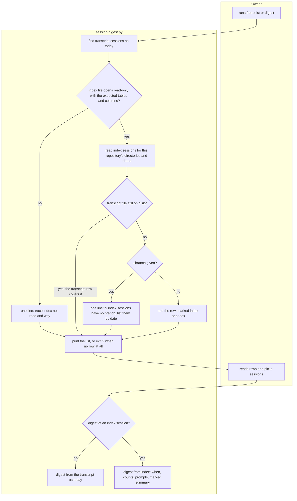

# DESIGN-003-defect-ledger-t2

Based on: RESEARCH-003-defect-ledger-t2.md

## What we learned from Tier 1
- Nothing from use: the tier plan's Feedback is empty, and no application has a defect ledger line yet (the first monthly report runs 2026-12-01). Every need below is measured on this machine, not learned from the ledger.
- **Kept:** DEFER-001, `/retro` reads the trace index when a transcript is gone, and lists Codex sessions. It is the one item with measured need: 5,896 of the 7,166 Claude sessions in the index have no transcript file left.
- **Moved to Tier 3:** DEFER-002 (renumber duplicate ids at merge) and DEFER-003 (report an application on another machine) fail the Evidence test (neither event has happened) and the By-hand test (the merger renumbers; the owner runs `/defect-ledger report` on that machine). DEFER-008 (flow test harness) and DEFER-009 (tell an approved `log` from an unapproved one) fail the Evidence test (no flow-step regression or skipped approval seen) and each run needs real, billed, non-deterministic model calls. Each keeps the loud failure Tier 1 gave it.

## In one paragraph
When a retrospective reaches back past Claude Code's transcript retention, `/retro` today finds nothing and carries on with the SDD records and git alone. This tier lets its session script fall back on the **trace index** — the bb `traces` plugin's local SQLite file, which keeps every Claude and Codex session as short summaries of its events. A session whose transcript is gone, and every Codex session, is listed from the index beside the transcript sessions, and its digest shows what the index still holds: when it ran, its counts, and the user's prompts, every item marked as a summary. If the index is missing, locked, or not shaped as expected, the script says so in one line and works from transcripts as today.

## What you will be able to do afterwards
- Run `/retro since <date>` over a cycle older than the transcript retention and get that cycle's sessions listed, marked `index` with the directory they ran in.
- See this repository's Codex sessions (the cycle's reviews) in the same list, marked `codex`.
- Digest such a session and read its prompts and counts, each marked as an index summary.
- Run `/retro` on a machine without the bb `traces` plugin and get one line saying the index was not read, and nothing else changed.

## How it works today
- `retro/scripts/session-digest.py` reads only Claude Code transcript files: `find_sessions` (:247) walks `~/.claude/projects/` and keeps sessions whose recorded directory is one of this repository's live worktrees (`repo_roots` :231), or any with `--any-project`, then filters by branch and date.
- `list` (:399) exits 2 when nothing matches, and `retro/SKILL.md:44` then says "nothing found" and carries on with the SDD records and git; `digest` (:325) needs the transcript file.
- The trace index (`~/.bb/plugins/traces/data.db`) has one row per session (id `claude:<uuid>` or `codex:...`, directory, start and end, event, tool, error and token counts, the transcript path) and one row per event (line number, kind, role, a summary of up to about 1,000 characters). It records no git branch. Its raw text is empty. Subagent transcripts are indexed too.

## How it will work

Inputs it does not control: the trace index file — written by a third-party plugin, so its existence, its lock, its tables and columns, and every value in it (session ids, directories, timestamps, counts, summary text, transcript paths) — and the new path argument that names it.

State model: not applicable — the script reads and prints; nothing it adds moves through states.

## Key decisions
### D1: Tier 2 is the `/retro` fallback alone
- **Chosen:** build DEFER-001 only; move DEFER-002, -003, -008 and -009 to Tier 3.
- **Instead of:** the whole Tier 2 sketch plus DEFER-009.
- **Why:** only DEFER-001 passes the Evidence test (82% of indexed Claude sessions have no transcript). The others wait on events that have not happened and each has a by-hand route or a named refusal from Tier 1 (research → Whether the sketch still holds).
- **If this is wrong:** cheap — the owner names an item and it is added to this tier's spec.

### D2: Read the index directly, read-only, inside the existing script
- **Chosen:** `session-digest.py` opens the SQLite file read-only (no write, no lock taken, no "immutable" shortcut that could read a half-written file), with one new path option whose default is the bb location, as `--projects-dir` is for transcripts.
- **Instead of:** a new script or module, or a `bb` command.
- **Why:** there is no `bb traces` command (research); the script already owns listing and digesting sessions, and Python's standard library reads SQLite.
- **If this is wrong:** moderate — a schema change in the plugin breaks the reader; D5 keeps that to one line.

### D3: The transcript wins
- **Chosen:** an index session whose transcript file is still on disk is not listed again; the transcript row covers it. Index sessions follow the same directory rule as transcripts (this repository's live worktrees, or every directory with `--any-project`) and the same dates. With `--branch`, index sessions, which record no branch, are left out, and one line says how many index sessions of this repository have no branch and to list them by date (the owner's answer, revision 2).
- **Instead of:** listing both, or a new directory rule that guesses which removed worktree belonged to the repository; with `--branch`, listing every index session marked "branch unknown", which would add all of the repository's index sessions (321 here) to a branch list.
- **Why:** a transcript digest shows more; a guessed match could list another project's sessions.
- **If this is wrong:** cheap — a cycle run in a removed worktree is found with `--any-project` and dates, as transcripts already are.

### D4: A summary digest shows only what the index holds
- **Chosen:** for an index session: when, directory, source, model, the session's counts of tool calls, errors and tokens, and the user's prompts with their line numbers — headed by one line saying these are index summaries of a transcript that is gone, and that failed calls, lookup runs, repeats and subagent rows are not available.
- **Instead of:** rebuilding failed calls and lookup runs from summaries.
- **Why:** a Claude session's tool calls sit inside summarised assistant messages; rebuilding them would be a guess.
- **If this is wrong:** cheap — more items can be read from the event rows later.

### D5: Index trouble is one line, never a stop
- **Chosen:** a missing file, a locked database, a missing table or column, or an unreadable value gives one line on stderr naming the reason, and the run carries on with transcripts; exit status follows the rows found, as today.
- **Instead of:** failing the run, or staying silent.
- **Why:** the sketch's "no index → says so once and carries on"; a third-party schema can change without notice.
- **If this is wrong:** cheap.

### D6: Codex sessions are listed and digested by the same path
- **Chosen:** `codex` rows come from the index under the same directory and date rules and digest the same way as D4.
- **Instead of:** listing them without a digest, or reading Codex's own files.
- **Why:** since 3.9.0 a cycle's reviews run on Codex; the index already holds 292 Codex sessions of this repository.
- **If this is wrong:** cheap.

## Builds on
- `agent-engineering/skills/retro/scripts/session-digest.py:247` — `find_sessions`: the directory, branch and date filters index rows must follow.
- `…/session-digest.py:231` and `:243` — `repo_roots` and `under`: the repository's worktree paths and the path match.
- `…/session-digest.py:297` — `render_list`: the one table index rows join (with a source marker).
- `…/session-digest.py:325` — `render_digest` and `bullets` (:318): the digest layout a summary digest follows.
- `…/session-digest.py:90` and `:286` — `clip` and `local_day`: text clipping and the local-date rule.
- `…/session-digest.py:382` — the `--projects-dir` option: the pattern for the index path option.
- `agent-engineering/skills/retro/scripts/tests/test_session_digest.py:19` — the `Transcript` fixture builder the index fixture sits beside.
- `agent-engineering/skills/retro/SKILL.md:44` and `:60` — the "nothing found" line and the never-write-transcripts rule, which index text inherits.

## What changes where
| Area (path or path prefix; every new file by its own path) | New or changed | Lines added (estimate) | What changes (for a new file: why existing code cannot hold it) |
|---|---|---|---|
| `agent-engineering/skills/retro/scripts/session-digest.py` | changed | ~110 | index reader, its one-line refusals, index rows in `list`, summary digest, path option, docstring |
| `agent-engineering/skills/retro/scripts/tests/test_session_digest.py` | changed | ~140 | a hand-built SQLite index fixture; missing, locked, changed-schema index; transcript wins; branch note; Codex rows; summary digest; hostile summary text |
| `agent-engineering/skills/retro/SKILL.md` | changed | ~8 | step 1: index rows, the branch note, `--any-project` with dates for removed worktrees; step 2: summary digests |
| `agent-engineering/README.md` | changed | ~6 | retro entry and a changelog entry |
| `agent-engineering/.claude-plugin/plugin.json`, `.claude-plugin/marketplace.json` | changed | ~0 | version bump (two lines replaced) |

## Growth budget
- Source lines added: ~124
- Test lines added: ~140
- New files: 0

## Tiers
**Recommended: Tier 2.**
- **Tier 1 — POC-plus (shipped 5.5.0):** the committed defect ledger, `ledger.py`, the bug-fix rule, `/defect-ledger`, the monthly report.
- **Tier 2 — Standard:** the `/retro` fallback above. Leaves out everything in D1's move; each still fails loudly as Tier 1 left it (a named refusal; one report line; review only).
- **Tier 3 — Full (sketch):** two branches that added defect ledger lines merge without a hand renumber; the monthly report covers an application on another machine; an executable harness runs the flow's Markdown steps against fixtures, including telling an approved `log` from an unapproved one; the report proposes moves; defect ledgers read across applications; escape rate compared across sdd-flow, sdd-lite and plain Claude Code; a class re-labelled by command.

## Delivery outline (Tier 2)
1. Index sessions in the list — after this you can list an old cycle by date and see its index and Codex rows, and a broken or absent index gives one line.
2. Summary digest — after this you can digest an index session and read its counts and prompts marked as summaries.

## Not doing
- Writing to the trace index, or copying any of its text into the repository.

## Questions for you
None.

## Least sure about
- That the index's user-message rows are the user's prompts: in a Claude session, tool results are also user messages, and the summary may not show which is which. If false, a summary digest lists tool output as prompts — the first fixture to build from a real row's shape (not its text).
- That the plugin's schema holds through the cycle; it is version 0.1.1 with no contract. If it changes, D5 gives one line and the fallback is dead until the reader is updated.
- That most old cycles are found: many ran in BB worktrees since removed, so the default directory rule finds them only with `--any-project` and dates.
- Beyond the request: none

## Answers and changes
- **Revision 2.** Reply: "Q1: a (recommended)
Then approved." — Q1 answered (a): recorded in D3's Chosen and Instead of (index sessions left out of a `--branch` list, with one line counting them and saying to list them by date); `## Questions for you` is now `None.`. Nothing else changed.
